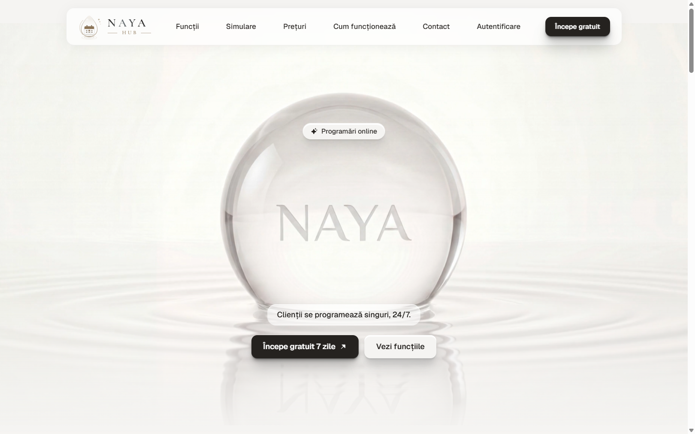
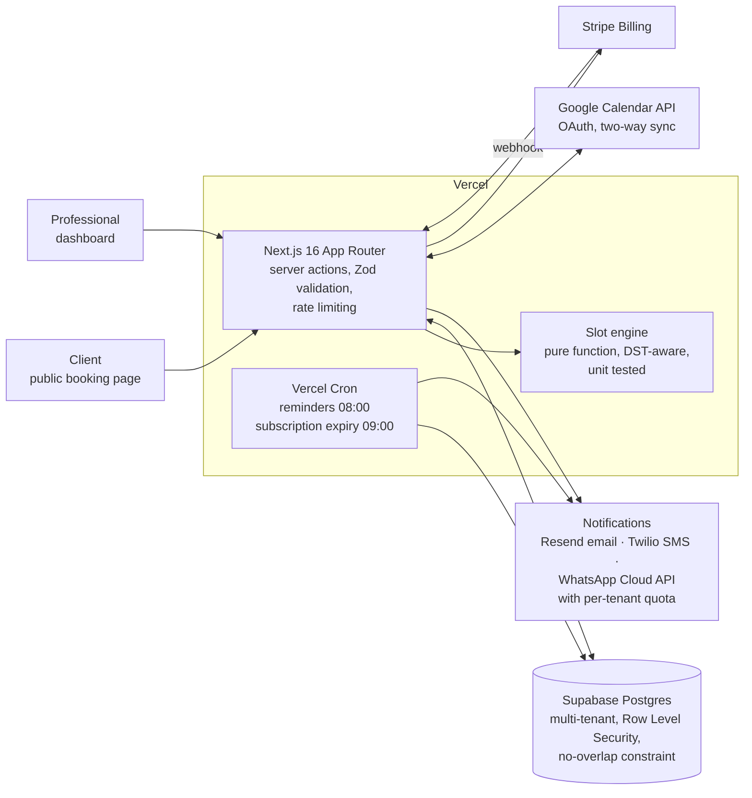

# Naya Hub: online booking for beauty professionals

**A live, multi-tenant booking SaaS.** Each salon or freelancer gets a public link (`naya-hub.com/<name>`). Clients pick a service, a specialist and a free slot on their own, 24/7; the professional gets the booking, the reminders go out automatically, and the subscription is billed monthly.

> **Live:** [naya-hub.com](https://naya-hub.com) · **Source code is private** (commercial product). This repository describes how it works; happy to walk through the code in an interview.

## What it does

- **Public booking page per business**, rendered on the server, with slots computed from the working schedule, breaks, days off and existing bookings.
- **Dashboard** for the professional: services, specialists, weekly schedule and per-date overrides, calendar, settings, subscription.
- **Confirmations and reminders** by email, SMS or WhatsApp, at an interval the professional chooses (1, 2 or 24 hours before). Clients cancel on their own through a private link with a one-off token.
- **Two-way Google Calendar sync** over OAuth.
- **Subscriptions** through Stripe Billing with a 7-day free trial; a daily job handles expired plans.
- **Installable** as a PWA on the phone.

## Architecture

**How a booking flows:** the client opens the public page → the server reads the schedule and the busy intervals for that specialist → the slot engine returns free slots in the business's time zone → the client picks one → the insert is validated and written; the database itself refuses an overlapping booking → confirmation goes out and the event appears in Google Calendar → the cron job sends the reminder at the chosen interval.

## Engineering decisions worth mentioning

- **Tenant isolation lives in the database.** Every business is an `organization`; users belong to it through memberships with roles. Row Level Security policies keep one tenant's data invisible to another, whatever the application code does.
- **Double booking is impossible, not just unlikely.** A Postgres exclusion constraint (`btree_gist`) on appointments rejects two active bookings that overlap for the same specialist, even when two clients press "book" in the same second.
- **The public page does not open the database to anonymous users.** It runs on the server with a scoped service role, so there are no "open" RLS policies for anonymous visitors.
- **Time is tested.** The slot engine is a pure function: schedule + busy intervals in, free slots out, with correct arithmetic on the days the clocks change. It is covered by unit tests.
- **Notification costs are capped.** Each tenant has an SMS/WhatsApp quota, decremented atomically in the database, so a bug or a busy month cannot run up the bill.
- **Cron endpoints are authenticated**, and the schema evolved through 11 versioned SQL migrations (constraints, triggers and indexes added as the product grew).

## Growth side

A separate lead-scoring pipeline (three n8n workflows) pulls local businesses from Google Maps through Apify, classifies each one into five web-presence states and computes a weighted 0–100 "needs a booking page" score. The scoring logic is a standalone JavaScript module with its own test suite.

## Stack

Next.js 16 · React 19 · TypeScript · Supabase (Postgres, Auth, RLS) · Stripe · Zod · Luxon · Vitest · Tailwind CSS 4 · Vercel (hosting + Cron) · Resend · Twilio · WhatsApp Cloud API · Google Calendar API · n8n · Apify

**Status:** live since 2026.
